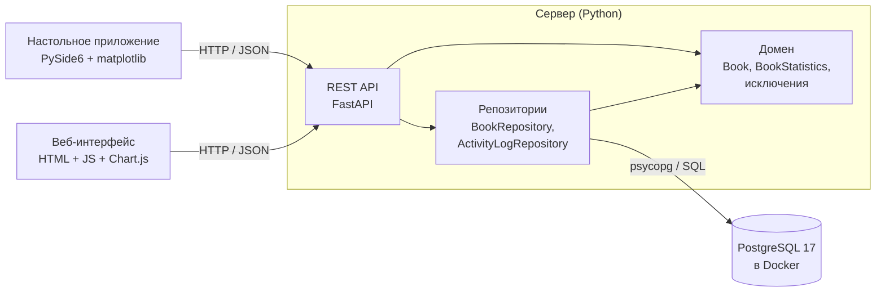
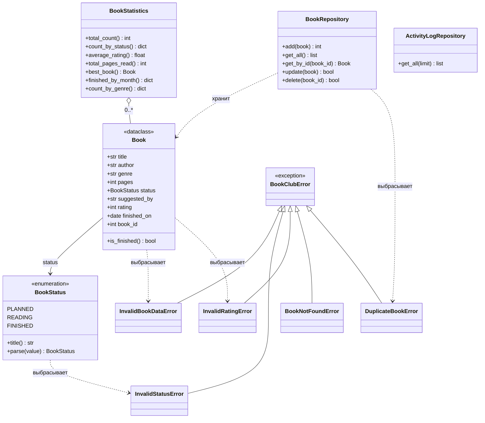
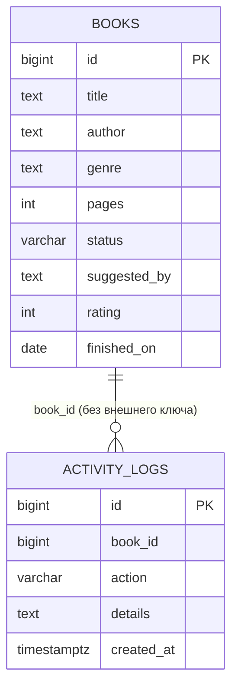

# BookClub — система учёта книг в книжном клубе

Лабораторная работа №3 «Работа с графическим интерфейсом на Python».
**Вариант 6** · **Сложность: Well-done** (GUI + БД + тесты + веб-версия + Docker)

BookClub помогает книжному клубу вести общий список книг: кто предложил книгу,
в каком она статусе, какую оценку поставил клуб и когда книга была дочитана.
Данные хранятся в PostgreSQL и доступны сразу из двух интерфейсов:

| Интерфейс | Технологии | Что даёт |
|-----------|-----------|----------|
| Настольное приложение | PySide6, matplotlib, httpx | Таблица, форма, меню, статистика, график, журнал |
| Веб-версия | FastAPI, HTML/JS, Chart.js | То же самое в браузере + документация API |

## Возможности

- Добавление, редактирование и удаление книг
- Статусы чтения: **В планах → Читаем → Прочитана**
- Оценка 1–5 и дата окончания чтения для прочитанных книг
- Статистика: число книг, средняя оценка, прочитано страниц, лучшая книга
- График активности клуба — сколько книг прочитано по месяцам
- Журнал действий: создание, изменение, удаление
- Защита от дубликатов (название + автор) и некорректных данных
  через собственные исключения

## Архитектура

Настольное приложение и браузер не обращаются к базе напрямую — оба работают
через REST API. Вся бизнес-логика живёт в доменном слое и не зависит ни от
интерфейса, ни от базы данных.



### Классы




### База данных



Внешнего ключа между таблицами нет намеренно: записи журнала должны
сохраняться после удаления книги.

## Структура проекта

```
bookclub/
├── domain/        Book, BookStatus, BookStatistics, собственные исключения
├── database/      подключение к PostgreSQL, схема, репозитории, seed.py
├── api/           REST API на FastAPI (main.py, schemas.py)
├── desktop/       интерфейс PySide6: окно, вкладки, клиент API
└── web/           веб-интерфейс: index.html, style.css, app.js
tests/             тесты pytest (домен, репозиторий, API)
compose.yaml       PostgreSQL в Docker
```

## Инструкция по запуску

Нужны **Python 3.11+**, **Docker Desktop** и Git. Все команды выполняются
из корня проекта (PowerShell).

**1. Окружение и зависимости**

```powershell
python -m venv .venv
.venv\Scripts\activate
python -m pip install -r requirements.txt
```

**2. Настройки.** Скопируйте `.env.example` в `.env` и задайте свой пароль
в `BOOKCLUB_DB_PASSWORD`:

```powershell
copy .env.example .env
```

**3. База данных** (Docker Desktop должен быть запущен):

```powershell
docker compose up -d
python -m bookclub.database.schema
```

**4. Сервер API и веб-версия:**

```powershell
python -m uvicorn bookclub.api.main:app --reload
```

- Веб-интерфейс: http://127.0.0.1:8000/web/
- Документация API (Swagger): http://127.0.0.1:8000/docs

> Если порт 8000 недоступен (`WinError 10013` — порт зарезервирован Windows),
> запустите сервер на другом порту, например `--port 8765`, и укажите тот же
> адрес в `.env`: `BOOKCLUB_API_URL=http://127.0.0.1:8765`.

**5. Настольное приложение** — в **отдельном** терминале при запущенном сервере:

```powershell
python -m bookclub.desktop.main
```


## REST API

| Метод | Путь | Назначение | Коды ответа |
|-------|------|-----------|-------------|
| GET | `/books` | список книг | 200 |
| POST | `/books` | добавить книгу | 201, 409, 422 |
| GET | `/books/{id}` | получить книгу | 200, 404 |
| PUT | `/books/{id}` | изменить книгу | 200, 404, 422, 409 |
| DELETE | `/books/{id}` | удалить книгу | 204, 404 |
| GET | `/statistics` | статистика и данные для графика | 200 |
| GET | `/activity-log` | журнал действий | 200 |

Собственные исключения приложения преобразуются в HTTP-коды:
ошибки данных → `422`, книга не найдена → `404`, дубликат → `409`.

## Тестирование

```powershell
python -m pytest -v
```

Тесты делятся на две группы: доменные (модель, статистика) не требуют базы,
интеграционные (репозиторий, API) автоматически создают и используют отдельную
базу `bookclub_test`, рабочие данные не затрагиваются. Если PostgreSQL
недоступен, интеграционные тесты пропускаются.

## Краткая справка

1. **Добавить книгу.** На вкладке «Книги» заполните «Название», «Автор»,
   «Жанр», «Страниц» и нажмите «Добавить».
2. **Прочитанная книга.** Выберите статус «Прочитана» — станут доступны дата
   окончания и оценка (1–5).
3. **Изменить или удалить.** Выберите книгу в таблице, поправьте поля и нажмите
   «Сохранить изменения» либо «Удалить».
4. **Статистика.** Вкладка «Статистика» показывает показатели клуба и график
   «прочитано книг по месяцам».
5. **Журнал.** Вкладка «Журнал» — история всех добавлений, изменений и удалений.
6. **Обновить данные:** `F5`. **Выход:** меню «Файл → Выход» или `Ctrl+Q`.

Если приложение сообщает «Не удалось подключиться к серверу» — запустите
сервер API (шаг 4). Подробности работы пишутся в файл `bookclub.log`.

## Соответствие заданию

| Уровень | Требование | Где реализовано |
|---------|-----------|-----------------|
| Rare | ООП | `domain`, `database`, `desktop` — классы, наследование, композиция |
| Rare | Таблица, поля ввода, кнопки, лейблы | `desktop/books_tab.py` |
| Rare | График активности | `desktop/statistics_tab.py` |
| Rare | Логирование активности | `desktop/activity_tab.py`, таблица `activity_logs` |
| Rare | Меню и выход | `desktop/main_window.py` |
| Rare | Собственные исключения | `domain/exceptions.py`, `desktop/api_client.py` |
| Rare | README.md | этот файл |
| Medium | БД | PostgreSQL, `database/` |
| Medium | Тесты pytest | `tests/` |
| Well-done | Веб-версия на FastAPI | `api/`, `web/` |
| Well-done | БД в Docker | `compose.yaml` |
